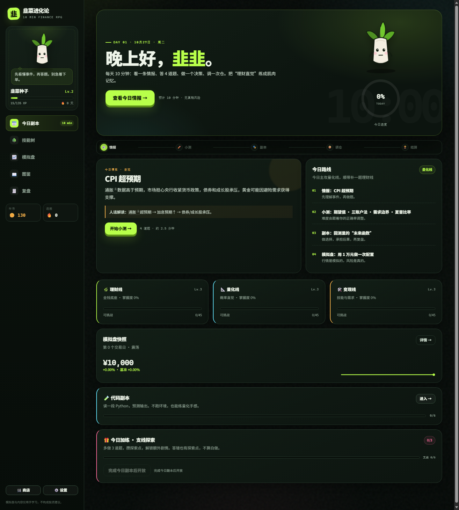
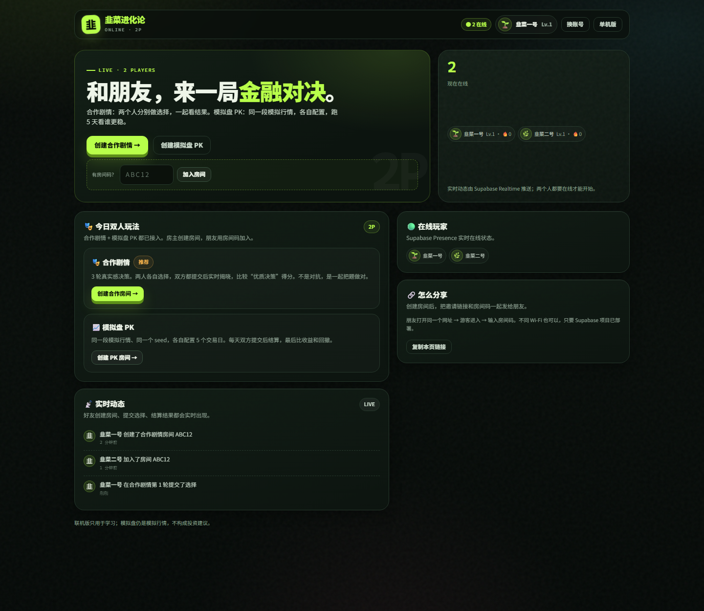
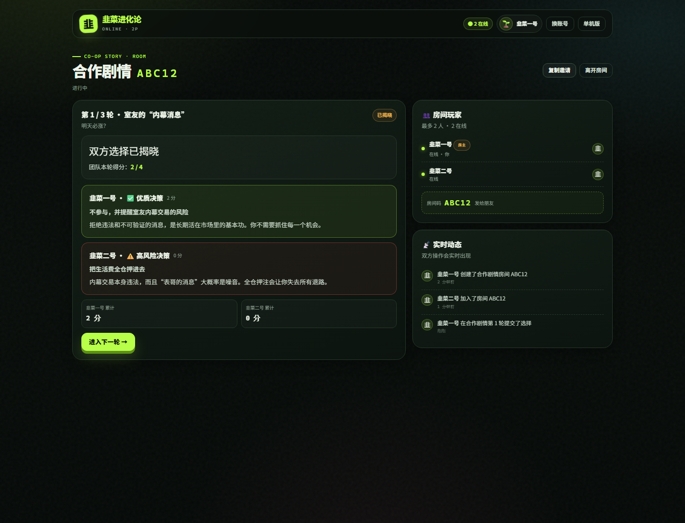
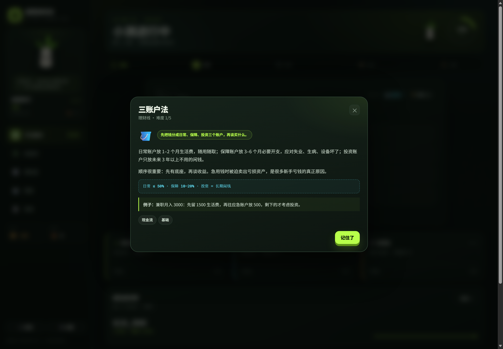
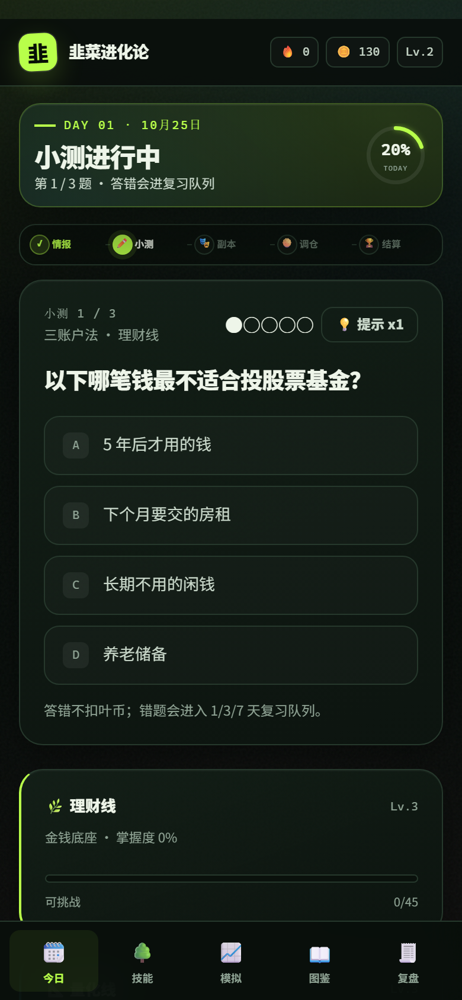

# 韭菜进化论 · 10 分钟金融副本

一个每天 10 分钟的金融学习 RPG。不是“什么都讲一点”的网课，而是一个固定循环：

> 看情报 → 答 4 道题 → 做一个真实感决策 → 调一次模拟仓 → 结算奖励

难度会跟着你的答题表现变，三条成长线分别对应你的三个目标：**理财赚钱、判断量化适性、探索副业变现**。



## 直接开始

**方式一：双击 `start.bat`**  
最简单，直接用默认浏览器打开 `index.html`。

**方式二：运行 `start-server.ps1`**（推荐）  
会起一个本地静态服务器并自动打开浏览器。`localStorage` 存档和剪贴板复制会更稳。

```powershell
powershell -ExecutionPolicy Bypass -File .\start-server.ps1
```

**方式三：直接打开 `index.html`**  
纯前端、无后端、无构建步骤。现代 Chrome / Edge / Safari 都可以。

第一次进入先做 **12 题诊断**（约 3 分钟），也可以点“先跳过，直接开始”。之后每天点“开始今日副本”。

## 联机版（Beta）：两个账号，不同网络

单机版不需要后端；**联机版**需要 Supabase（免费）做账号、房间和实时同步，前端仍然可以部署在 GitHub Pages。

- 入口：`online.html`，或单机版左侧导航的 **“🌐 联机”**
- 两个游客账号或邮箱账号，各自有昵称
- 实时在线状态、动态流
- 邮箱登录：跨设备同步云存档
- 单机云存档：每次存档后自动上传 Supabase，换设备可恢复
- **合作剧情**：3 轮决策，双方提交后揭晓
- **模拟盘 PK**：同一段模拟行情，各自配置 5 天，比收益和回撤
- 支持 PWA：手机浏览器“添加到主屏幕”后像 App 一样打开





从零部署（创建 Supabase 项目、运行 SQL、开匿名登录、GitHub Pages）：  
👉 [ONLINE_SETUP.md](ONLINE_SETUP.md)

> GitHub Pages 只能托管静态页面，不能单独跑数据库/实时服务；联机的后端在 Supabase。
> 联机版模拟盘仍是模拟行情，不构成投资建议。

## 每天 10 分钟怎么走

1. **情报**（30 秒）：一条宏观 / 行业事件，配一句“人话解读”。
2. **小测**（2.5 分钟）：4 道自适应题。答对变难，答错进 1/3/7 天复习队列。
3. **剧情副本**（3 分钟）：内幕消息、基金止盈、回测陷阱、第一单报价……选完看复盘。
4. **模拟盘**（2 分钟）：1 万元虚拟资金，调股 / 债 / 金 / 现金比例，经历一个交易日。
5. **结算**（1 分钟）：XP、叶币、连胜、成就、技能树节点奖励。

## 加练与支线：多做的题有去处

完成今日副本后，会开放 **“加练 3 题”**：

- 每答 1 题得 **1 点探索点**，答错也算，不用怕“白做”。
- 3 点解锁 **1 个支线副本**（共 6 个），是独立的小剧情决策，给额外 XP / 叶币。
- 每天最多解锁 1 个支线；支线进度会累计，不会挤占主线。
- 额外题也会更新概念掌握度和复习队列，所以多做真的有用。

## 名词卡：不用切出去搜概念

题目、选项、事件解读里带 `i` 的词都可以直接点开；小测右上角也有“📖 名词卡”按钮。  
比如做到“通胀 3%、存款 1.5%”时，点“通胀”就会弹出定义、公式和例子，诊断题里同样可用。



## 三条成长线

| 线 | 你会练到什么 | 最终产出 |
|---|---|---|
| 🌿 **理财线** | 三账户、应急金、复利、指数基金、股票本质、估值、资产配置、回撤、A 股规则、杠杆、FOMO | 能独立做一份“不亏先于赚钱”的配置 |
| 📐 **量化线** | 期望值、方差、厚尾、幸存者偏差、基准率、相关与因果、过拟合、回测陷阱、夏普、凯利、因子、蒙特卡洛 | 判断自己是否享受“验证假设”，并做出第一个含成本的回测 |
| 🛠️ **变现线** | 技能盘点、需求三角、范围、数据清洗、自动化、作品集、报价、交付、合规、内容获客 | 跑通一次“需求 → 交付 → 收款”的闭环 |

## 自适应是怎么工作的

- **诊断**：12 题估出三条线的初始能力（θ）和风险类型。
- **选题**：优先当前技能节点 + 薄弱线 + 到期复习题，难度贴着“跳一跳够得着”。
- **更新**：答对/答错用 Elo 式更新 θ；每个概念有 0–100 的掌握度；错题按 1/3/7/14 天间隔复习。
- **技能树**：当前节点平均掌握度到 **45%** 就点亮，解锁下一段；节点奖励会自动发放。
- **加练不原地重复**：先出当前节点的新题，不够时按顺序带到下一节点；整条线都练过，才按“最久没练”的顺序复习。
- **题库干扰项**：错误选项按常见误解、相邻概念、计算错误设计；正确答案位置已均衡打乱，不能靠“总选 B”蒙。
- **每周复盘**：正确率、优质决策、量化适性报告、决策日志；完成 5 天解锁 Boss 战。

## 模拟盘

- 初始 1 万元，5 类资产：现金 / 债券基金 / 沪深 300 / 黄金 / 科技成长。
- **没有接入真实股市 API**：所有价格都是本地模拟器生成的，不随真实市场波动；“沪深 300”只是模拟资产类别，不是实时指数。
- 每个交易日可调一次仓，按成交金额收 0.1% 模拟手续费；也可以“保持不动”。
- 行情由带 regime（牛 / 熊 / 震荡）的随机过程 + 事件冲击生成，**不是真实行情或历史回放**。
- 看的是配置、回撤、波动和情绪反应，不是预测明天。

## 游戏化

- 等级 / 称号：韭菜种子 → 嫩芽 → 青铜韭菜 → 白银韭菜 → 黄金韭菜 → 量化学徒 → 量化猎人 → 镰刀克星。
- 连胜、叶币、每日宝箱、22 个成就、连胜冻结卡、提示券。
- 吉祥物“韭韭”会随等级进化；商店可买冻结卡、提示券和装扮。
- 只跟“市场先生”和“过去的自己”比，没有真人排行榜。

## 存档

- 单机进度默认保存在浏览器 `localStorage`；配置 Supabase 后会**自动云存档**到 `saves` 表。
- 联机版的账号、房间和动态保存在你自己的 Supabase 项目里。
- 云存档约 1.2 秒防抖上传；打开时按时间戳恢复较新的版本。
- 游客云存档只在本设备有效；跨设备请在联机版用**邮箱登录**。
- **注意**：直接打开 `index.html`（`file://`）和通过本地服务器（`http://127.0.0.1`）访问，浏览器会把它们当成不同来源，存档不互通。建议固定一种方式，推荐 `start-server.ps1`。
- **设置 → 导出存档** 下载 JSON；换设备或清缓存前先备份。
- **设置 → 导入存档** 覆盖当前进度。
- **设置 → 重置进度** 清空重来（不可撤销）。

## 内容库

当前版本包含：

- 48 张概念卡
- 64 道题（含诊断题）
- 14 个剧情副本 + 6 个支线副本
- 10 个市场事件
- 6 个代码副本（读 Python 片段、预测输出）
- 15 个技能节点
- 22 个成就
- 2 个联机模式：合作剧情、模拟盘 PK
- 1 套 Supabase 房间 / 实时动态 / 在线状态

## 想自己加内容

所有内容都是纯 JS 数据，不需要构建：

- `js/concepts.js`：概念卡 + 三条线的元信息 + 诊断题 ID。
- `js/terms.js`：名词卡别名 + 概念卡之外的名词（CPI、基金净值、印花税等）。
- `js/questions.js`：题目。字段：`id / track / concept / difficulty / stem / options / answer / explain`。`answer` 是 0 开始的选项下标；`diagnostic: true` 表示会进诊断池。
- `js/cases.js`：剧情副本、市场事件、技能节点、成就、商店、称号。
- `js/engine.js`：状态机、自适应、模拟盘、结算、周复盘、加练轮转。
- `js/app.js`：所有界面渲染和交互。
- `assets/style.css`：视觉系统。

改完直接刷新页面即可。

## 开发者测试

```powershell
# 纯逻辑测试，无依赖
node tests/engine.test.js
node tests/online.test.js
node tests/online-static.test.js

# UI 冒烟测试（可选，需要 jsdom）
npm install jsdom --no-save --cache .npm-cache
# 终端 A：起并发静态服务器（避免 jsdom 等脚本时超时）
node tests/serve.js
# 终端 B：
node tests/ui-smoke.js
node tests/online-ui.js
node tests/online-auth.js
node tests/online-flow.js
node tests/cloud-save.test.js
```

`tests/ui-smoke.js` 默认访问 `http://127.0.0.1:8899/`；换端口用 `TEST_URL`，并给 `tests/serve.js` 设 `PORT`。

## 预览参数

这些参数只用于本地预览 / 截图，不影响正常使用：

- `?demo=1`：跳过诊断，用默认起点直接看仪表盘。
- `?demo=1&view=skills`：直接看技能树。
- `?demo=1&view=portfolio`：直接看模拟盘。
- `?demo=1&stage=quiz|case|trade`：直接看每日循环的某一步。
- `?demo=1&view=skills&track=quant`：直接看量化线。
- `online.html?demo=home|coop|coop-reveal|portfolio|portfolio-result`：联机页面预览（不需要 Supabase，按钮不可操作）。

## 设计取舍与边界

- **先指数基金，再个股**：对没有信息优势的学生，宽基指数是更现实的起点；个股内容放在“基金与股票入门”节点，讲本质和估值，不推荐具体标的。
- **纯模拟盘**：不接真钱、不接券商、不提供交易信号，避免把学习工具变成冒险工具。
- **代码副本不跑 Python**：用“读代码 → 预测输出”避免几 MB 的浏览器 Python 运行时；想真跑代码，可以把片段复制到本地 Jupyter。
- **量化适性是“动态报告”，不是测评结论**：它基于你的答题、代码副本和模拟盘行为，只给下一步实验建议，不给你贴“适合/不适合”的终局标签。
- **内容仅用于学习，不构成投资建议**。真实投资有本金损失风险。

## 文件结构

```
leek-finance-rpg/
├─ index.html
├─ online.html              # 联机版入口
├─ manifest.webmanifest     # PWA
├─ sw.js
├─ ONLINE_SETUP.md          # Supabase + GitHub Pages 部署
├─ supabase/
│  └─ schema.sql            # 表 + RLS + Realtime
├─ assets/
│  ├─ style.css
│  ├─ online.css
│  └─ icon-192.png / icon-512.png
├─ js/
│  ├─ concepts.js
│  ├─ terms.js
│  ├─ questions.js
│  ├─ cases.js
│  ├─ engine.js
│  ├─ app.js
│  ├─ vendor/supabase.js
│  └─ online/
│     ├─ config.js
│     ├─ game.js            # 合作/模拟盘纯逻辑
│     ├─ supabase.js        # Supabase 适配器
│     ├─ online.js          # 联机 UI
│     └─ cloud-save.js      # 单机云存档
├─ .github/workflows/pages.yml
└─ tests/
   ├─ engine.test.js
   ├─ online.test.js
   ├─ online-static.test.js
   ├─ serve.js
   ├─ ui-smoke.js
   ├─ online-ui.js
   ├─ online-auth.js
   ├─ online-flow.js
   └─ cloud-save.test.js
```


